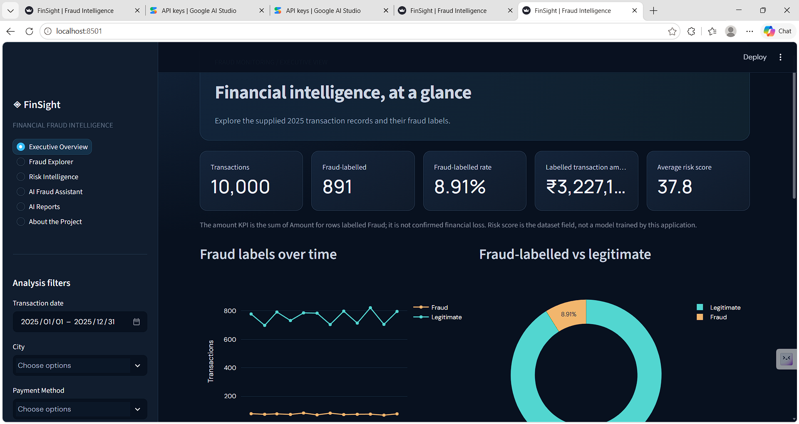
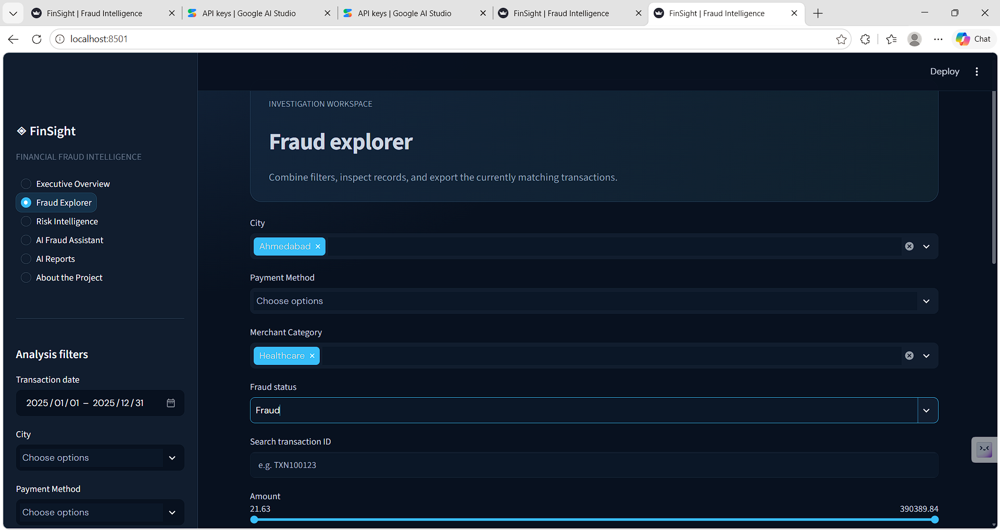
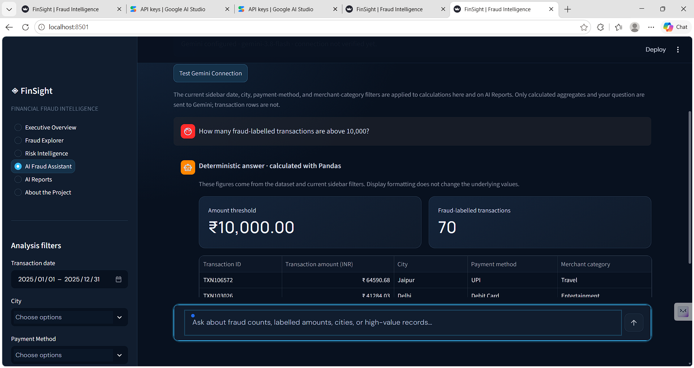
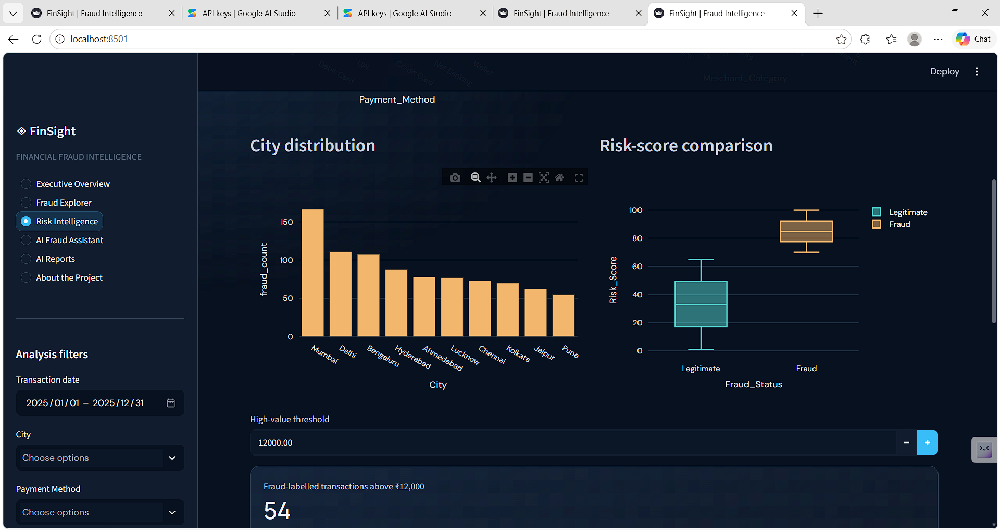
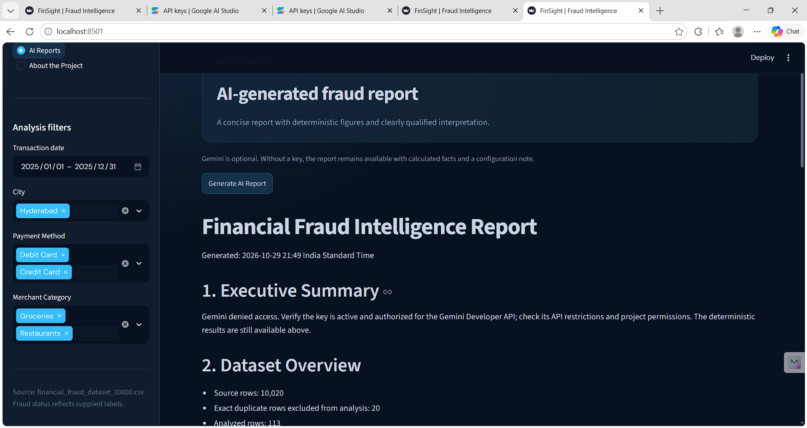
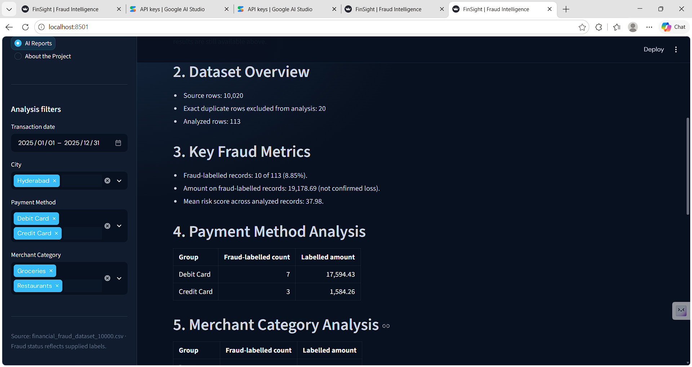
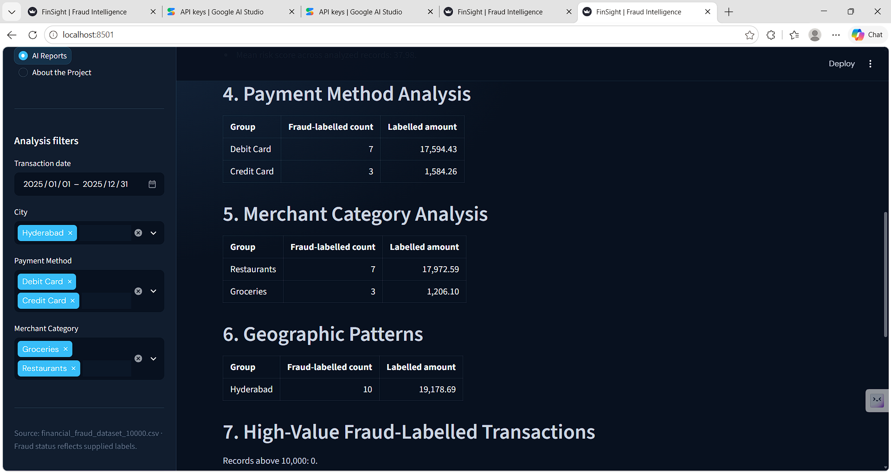

# Financial Fraud Analysis

## 📌 Project Overview

### Dashboard Previews


This project focuses on identifying patterns and trends in fraudulent financial transactions. By leveraging **SQL, Power BI, and Excel**, we analyze a dataset of 10,000 transactions to uncover key insights related to fraud behavior, risk scores, geographical hotspots, and merchant categories. 

The goal of this analysis is to provide actionable intelligence that can help financial institutions mitigate risks and improve their fraud detection systems.

## 🛠️ Tools Used
- **SQL:** Used for querying, filtering, and aggregating the dataset to extract meaningful insights (e.g., finding the top fraud locations and analyzing high-value fraud transactions).
- **Power BI:** Used for building an interactive and dynamic dashboard (`dashboard.pbix`) to visualize fraud trends, making it easier for stakeholders to understand the data at a glance.
- **Excel:** Used for initial data inspection, cleaning, and managing the raw dataset (`financial_fraud_dataset_10000.csv`).

## 📊 Dataset Description
The dataset contains 10,000 transaction records with the following key attributes:
- `Transaction_ID` & `Customer_ID`
- `Amount` & `Transaction_Date`
- `Transaction_Type` (e.g., Deposit, Withdrawal, Transfer)
- `Payment_Method` (e.g., Credit Card, UPI, Net Banking)
- `Fraud_Status` (Legitimate vs. Fraud)
- `Risk_Score` (System-generated risk assessment)
- `City`, `Age_Group`, and `Bank_Name`

## 💡 Key SQL Queries & Analysis
The `fraud_analysis_queries.sql` file contains queries that answer critical business questions:
1. **Geographical Impact:** Which cities have the highest volume of fraudulent transactions?
2. **Payment Method Vulnerabilities:** What is the average risk score and total fraud amount associated with different payment methods?
3. **Targeted Merchants:** Which merchant categories (e.g., Travel, Electronics, Shopping) experience the highest fraud activity?
4. **High-Value Fraud:** Identifying large fraudulent transactions (Amount > 10,000) for immediate investigation.
5. **Demographic Trends:** Which age groups are most susceptible to financial fraud?

## 🚀 How to Run the Project
1. **SQL:** Run the scripts provided in `fraud_analysis_queries.sql` on your preferred SQL database management system (e.g., SQL Server, MySQL, PostgreSQL) after importing the CSV file.
2. **Power BI:** Open the `dashboard.pbix` file using Power BI Desktop to interact with the visualizations and explore the data.

## FinSight Streamlit Fraud Intelligence App

The project now includes an interactive Streamlit application alongside the original SQL analysis, dataset, screenshots, and Power BI dashboard. The app provides Executive Overview, Fraud Explorer, Risk Intelligence, AI Fraud Assistant, AI Reports, and project documentation pages.

### Technology and architecture

- **Streamlit** renders the dashboard and page navigation.
- **Pandas** validates data types and performs all filtering and analytical calculations.
- **Plotly** renders interactive charts.
- **Google Gen AI SDK (`google-genai`)** uses the current Interactions API for optional explanations. A controlled intent router chooses supported operations, computes values in Pandas, and sends only compact aggregates and the question to Gemini. Requests use `store=False`; the app does not send the full CSV or transaction identifiers.

Analytical values are deterministic. AI text is an interpretation that requires review. The assistant suppresses generated explanations containing digits so numerical results are read from the deterministic calculations displayed alongside them. Unsupported questions receive a clear limitation response. No predictive fraud model is implemented.

### Data workflow and definitions

The source CSV remains unchanged. The supplied file contains 10,020 rows, including 20 exact repeated records; the app drops only those exact duplicates in the in-memory analysis view and reports the removed count. Missing or invalid amounts are excluded from amount sums. Fraud means `Fraud_Status` equals `Fraud` (case-insensitive). The sum of amounts on fraud-labelled records is **not confirmed financial loss**. The source `Risk_Score` is displayed as provided and is not produced by this app.

### Install and launch on Windows

From this project directory, use PowerShell:

```powershell
py -m venv .venv
.\.venv\Scripts\Activate.ps1
python -m pip install --upgrade pip
pip install -r requirements.txt
streamlit run app.py
```

Open the local URL printed by Streamlit (normally `http://localhost:8501`). If `py` is not installed, use `python -m venv .venv` instead.

### Optional Gemini configuration

Copy `.env.example` to `.env` and set `GEMINI_API_KEY` to your own key. `python-dotenv` loads this ignored local file before the app reads the key. You can instead set the variable in PowerShell for the current session with:

```powershell
$env:GEMINI_API_KEY = "YOUR_KEY"
streamlit run app.py
```

Optionally set `$env:GEMINI_MODEL` to a model enabled for your account. The default `gemini-3.8-flash` is currently listed as stable in the Gemini model catalog. The AI Fraud Assistant’s **Test Gemini Connection** button makes one minimal request only when clicked; the app does not test automatically on reruns. Never commit a real key. The `.gitignore` excludes `.env`. With no key, all non-AI pages, calculations, and CSV exports remain available; AI pages show a missing-key message and deterministic results.

### Tests

```powershell
python -m pytest tests -q
```

The tests cover metric definitions, exact duplicate handling, missing/invalid values, unsupported questions, threshold extraction, missing credentials, and graceful API failures.

### Limitations

This application summarizes the supplied static, labelled dataset. Group counts do not normalize by the number or value of transactions in each group. Correlation or frequency does not establish causation. Dataset labels may not represent adjudicated outcomes. AI text can be wrong and must be verified. Reports are downloadable as Markdown; PDF export is not included.

The original `dashboard.pbix`, SQL script, screenshots, and CSV remain available in this project.

### Updated Streamlit app screenshots

| Executive overview | Fraud explorer |
| --- | --- |
|  |  |

| AI assistant | Risk intelligence |
| --- | --- |
|  |  |

| AI report | Report metrics | Report analysis |
| --- | --- | --- |
|  |  |  |
